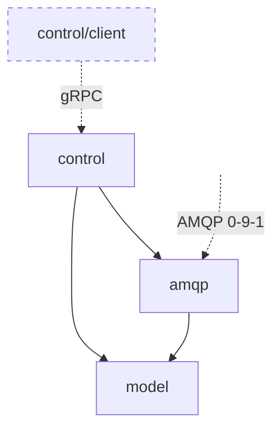
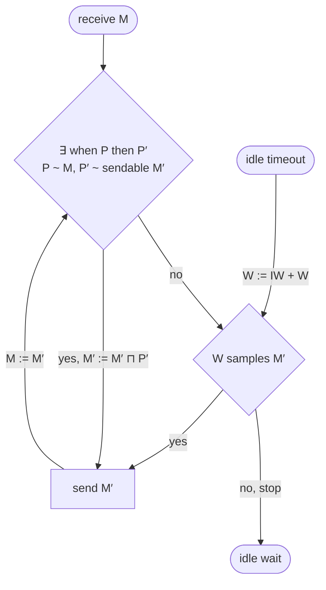

# AMQP Imposter

## About the project

The imposter is an AMQP 0-9-1 server that knows which methods are legal at each step of a client-server interaction, and lets you control its behaviour.

In practice, many client bugs lurk in rare interactions that are hard to explore by handwriting tests.
With the imposter, you can:

- **Fuzz** clients with weighted sampling and then check an interaction transcript.
- **Reproduce** tricky interactions with deterministic `when-then` rules on server state transitions, letting the imposter fill in the gaps with values that are legal in the current state.

It supports one channel over one connection at a time.

## Getting started

### Prerequisites

Python 3.15 or later.

### Installation

Add this package to your test dependencies.
See [Usage](#usage) for how to spawn an imposter server using Python or the command line.

## Usage

### Python

The `amqp_imposter` context manager runs and configures an imposter subprocess on available ports.
An example test written using the imposter:

<!-- fmt:off -->
```py
import pytest
from amqp_imposter.control.client import amqp_imposter, pb


@pytest.mark.parametrize("seed", range(500))
def test_my_client(seed: int) -> None:
    """
    Interact with the imposter, then check a desired property of the interaction.
    """
    config = pb.SessionConfig(seed=seed)

    with amqp_imposter(config) as imposter:
        run_my_client(imposter.amqp_port)

        transcript = imposter.transcript()
        assert check_my_property(transcript), str(transcript)
```

The runs above each spawn their own imposter process, so they can be parallelised, for example using `pytest-xdist`.
If running serially, calling `imposter.configure(config)` will disconnect the client and prepare a new session on the same imposter process.

Optionally tune the behaviour of the imposter with weights and scripts.

```py
from amqp_imposter.control.client import (
    pb,
    weighted,
    when_receive,
)

script = (
    when_receive(pb.BasicPublishPattern(), then_send=pb.BasicReturnPattern()),
)
weights = (
    weighted(pb.BasicAckSelector(), pb.BASE_WEIGHT // 2),
    weighted(pb.ConnectionCloseSelector(class_id=0, method_id=0), pb.BASE_WEIGHT // 20),
)

config = pb.SessionConfig(script=script, weights=weights, seed=seed)
```
<!-- fmt:on -->

### Other languages

Run the imposter as a foreground process from a command line:

```
amqp-imposter [--socket <path>] [--amqp-port <port>]
```

then read the first line of `stdout` for the control socket and AMQP port.
If the imposter created the socket, it will be cleaned up on `SIGINT`/`SIGTERM`.

```json
{"socket": "/tmp/amqp-imposter-<pid>/control.sock", "amqp_port": 5672}
```

Configure the imposter over gRPC on the socket using the proto schema (see [How does the control server work?](#how-does-the-control-server-work)).

## How it works

### Internal packages



**Package** | **Purpose**
:--- | :---
[model](amqp_imposter/model) | Core logic and model state
[amqp](amqp_imposter/amqp) | AMQP server, framing and session data
[control](amqp_imposter/control) | Control server, configuration and management
[control/client](amqp_imposter/control/client) | Built-in Python client for the control server

### How does the AMQP server work?

The actual AMQP server is thin and sits atop the more complex logic model.
It frames its output, puts it on the wire, and tracks session state (the model state machine, a transcript of the interaction, etc.).
`pika` is used for framing.
The connection is in plaintext.

If the server detects that the client-server interaction has stalled (timed out idling since the last ingress method), it samples egress methods from the model to jumpstart it.
If there are no samples, then the client must owe us ingress.

### How does the control server work?

The control plane to manage the server speaks gRPC over a Unix domain socket.

- **Configure:** set the model parameters, reset the transcript and disconnect the client
- **Reset:** default the model parameters, reset the transcript and disconnect the client
- **Status:** see the AMQP port, whether there is an active client, the model parameters
- **Stream:** a copy of the transcript, with the events and methods exchanged
- **Watch:** stream transcript lines as they are recorded, until the session is reset

gRPC lets us generate typed messages for all of these to use with the language of the client under test.
It can also represent more complex AMQP data types, like tables.

### How does the model work?

During a session, what the imposter needs to track is the methods it may send next.
The server model is responsible for tracking these sendables.
It is a pure core and strongly decoupled from the imposter harness.

#### Methods and method patterns

Because the sendable methods are infinite, we have to represent this bag in terms of partially-specified methods.
A method field belongs to one of two categories:

- **Exact:** It is always derived from the model state.
    - When a method is in the bag, it has concrete values in all exact fields.
    - Example: `delivery-tag` in `basic.get-ok`.
- **Arbitrary:** It is not always derived from the model state.
    - When a method is in the bag, it does not necessarily have concrete values in all arbitrary fields.
    - Example: `redelivered` in `basic.get-ok`. It is sometimes in the bag with a concrete value, for instance if the message was requeued during this session. Other times, it can vary. A first-time delivery in this session could have been redelivered before, or not. In that case it is left empty, and a concrete value is generated when it's time to send it.

#### Model sampling

Sampling is configured with selectors, which can specify methods and any of their exact fields.

For example, you may set a high weight on `BasicReturnSelector()`, and some nonzero weight on `ConnectionCloseSelector(class_id=0, method_id=0)` to see that your producer republishes correctly after a disconnect.

The sampling algorithm collects the matches for all selectors in order, picks the lucky selector, samples one of its methods uniformly, and fills in the empty arbitraries.

You could separately weight `ChannelCloseSelector(reply_text="NOT_FORCED")` and `ConnectionCloseSelector(reply_text="NOT_FORCED")` to make unforced errors less likely to happen. (A forced error would be one that the model has to send, whereas unforced means it could choose to ignore it, like a missing exchange, which may or may not exist in a real broker.)

There is one special weight, the "stop weight".
The model keeps generating methods for a burst until no methods are left or this weight is sampled.

There is also a set of implicit selectors at the bottom of the order, to provide some defaults.
The implicit selectors weight everything as 100 with the exception of unforced and server-initiated teradown, which are weighted as 0.

On idle timeout, the imposter will also pass the special "idle weights" to the model, at the top of the order.
For example, you can use this to lower the chance of broker-initiated teardown during longer pauses by the client.

#### Model scripting

Scripting is configured with patterns that activate after any send or receive transition.

They sit above weighted selectors in the resolution order, including above the stop weight.
Therefore, you can configure the rules you want and let the imposter fall through to its own judgement when there is no match.

For example, configuring `when=received(basic.publish(*)), then_send=basic.ack(*)` means that after applying a received publish, the model should send an ack.
If the ack is not valid at that point, it will try the next matching pattern, in order.

Unlike selectors, patterns can also fix arbitrary fields.

Use the configurable "max burst length" to bound the bursts.
It is 1,000 by default and has to be a finite value to break out of infinite loops.

#### Model loop

Putting it all together:



Here, `~` denotes [unifiability](https://en.wikipedia.org/wiki/Unification_(computer_science)) and `⊓` the unification itself.
In our case, two methods are unifiable if they do not have fields with conflicting concrete values (see [Methods and method patterns](#methods-and-method-patterns)).

`W` represents the weighted selectors and `IW` the idle weighted selectors.

#### Representing topology

There is no persistent broker state; anything is fair game on a connection as long as it does not contradict the state of the interaction.
If your client declares an exchange, that does not permanently make the exchange exist inside the AMQP server you are talking to.
For example, in the imposter, publishing to an undeclared exchange will not deterministically produce a channel error and publishing to a declared one may still 404.

In practice, vhosts are shared resources and their topologies volatile.
All those states -- existence and non-existence, changed arguments, changed message counts, etc. -- need to be represented by the model, so it does not need to track past declarations and bindings.

### Decision register

See [model/docs](amqp_imposter/model/docs/).
